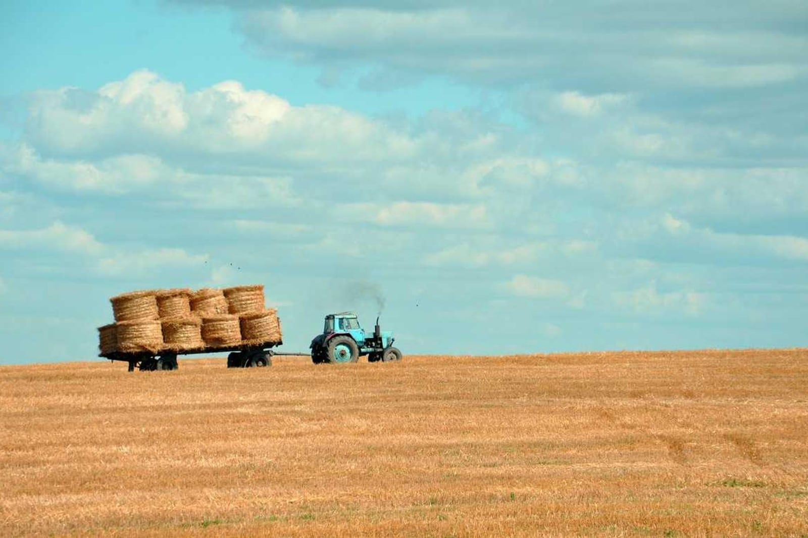
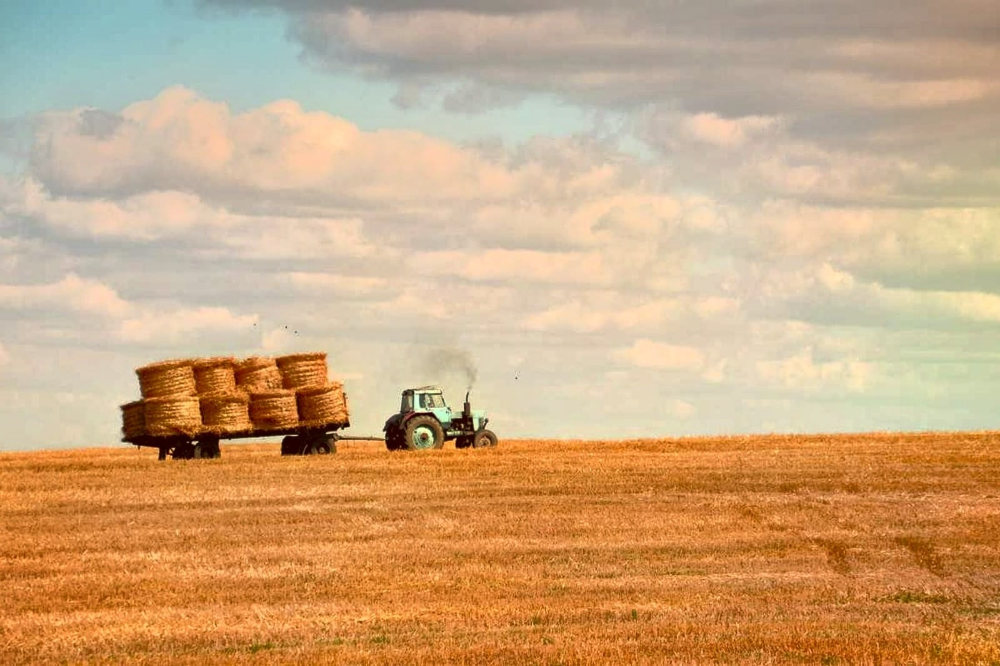
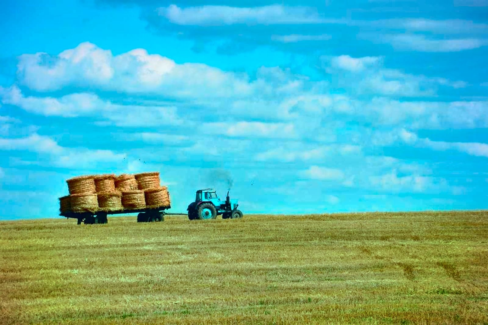
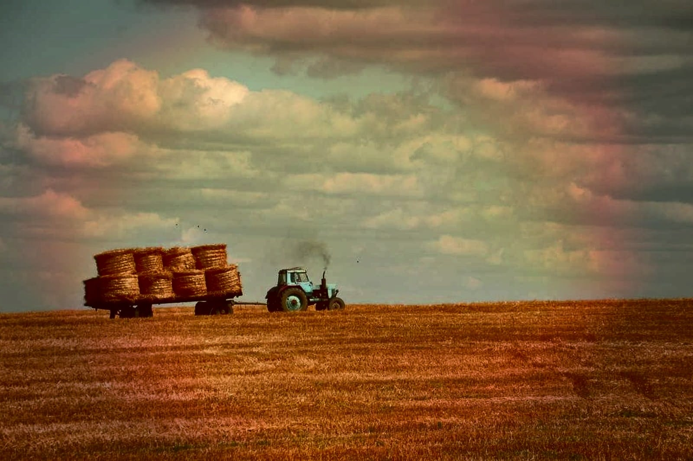
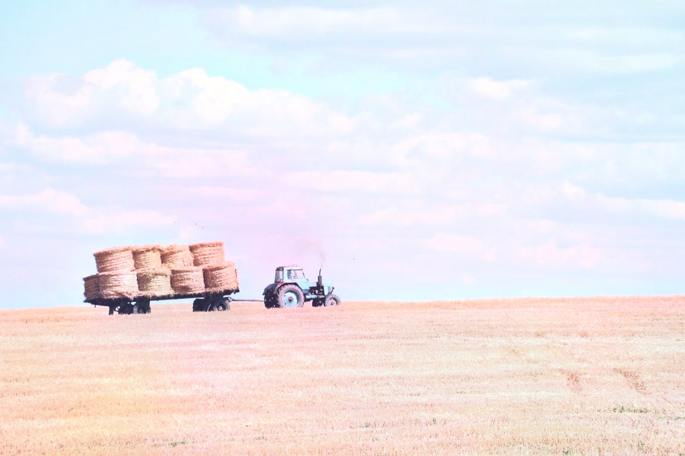

# Chromafy

The world, in another light.

Chromafy takes one ordinary photo and shows you the same moment in a different light. Choose a
world, and an image-editing model reworks the colour, light, contrast and atmosphere while the
subject and composition stay where they were.

Live at [chromafy-nine.vercel.app](https://chromafy-nine.vercel.app)

| Original | Golden | After Rain | Old Soul | Daydream |
| --- | --- | --- | --- | --- |
|  |  |  |  |  |

These are real results from the app, not mock-ups.

## The worlds

- **Golden**: late light that makes an ordinary place feel like somewhere you want to stay.
- **After Rain**: the cool, clean hush just after a shower has passed.
- **Old Soul**: a film-inspired memory of the scene, warm in the highlights and quiet in the reds.
- **Daydream**: soft pastel light, as if the scene were remembered on a very good day.

Can't decide? Surprise me picks one for you. Every world starts again from your original photo, so
you can keep trying others.

Results are artistic interpretations, not exact edits, and fine details can change.

## Using it

Upload a JPEG, PNG or WebP photo, or borrow one of the eight sample photos. Compare the result with
the original using a slider or side by side, then download it or share it. There are no accounts,
and each person gets five transformations a day.

## How it works

The browser sends only the photo and the name of the world. The server checks the request and the
image, re-encodes the photo to strip metadata such as GPS location, and sends it to FLUX.2 [klein]
on Cloudflare Workers AI with a prompt that never leaves the server.

The model works from a small copy of the photo, so Chromafy takes the colour and light from the
model's result and applies them to the full-resolution original. That keeps the photo's own detail
and framing. The result goes straight back to the browser and nothing is stored. An adapter for the
OpenAI Images API is included as an alternative provider.

## Privacy and security

Photos are processed in memory and never saved. There is no database, no accounts and no analytics.

API keys stay on the server, and the browser can choose a world but never a prompt or a model.
Before any work is done, each request has to pass an origin check, a Cloudflare Turnstile bot
check and per-person and global daily limits. Each upload is identified by its file signature and
checked for size. If the rate limiter is unavailable in production, transformations stop rather
than run unprotected.

Every control, and how it is tested, is listed in
[docs/security-checklist.md](docs/security-checklist.md).

## Built with

Next.js 16, React 19 and TypeScript, Tailwind CSS 4, Framer Motion, sharp, Upstash Redis, Cloudflare
Workers AI and Turnstile, with Vitest, Testing Library and Playwright for tests.

## Running it locally

You need Node.js 20.9 or later.

```bash
git clone https://github.com/LakshayJ17/chromafy.git
cd chromafy
npm install
cp .env.example .env.local
npm run dev
```

Then open [localhost:3000](http://localhost:3000). To turn transformations on, add a Cloudflare
Workers AI account ID and API token to `.env.local`. The free daily allowance is enough to try
it. Every setting is explained in [.env.example](.env.example).

`npm run check` runs lint, type checks, tests and a production build, and `npm run test:e2e` runs
the end-to-end tests in Chrome. The tests use a mocked image provider and never call a real model.

## Credits

Sample photos from [Unsplash](https://unsplash.com) (Unsplash License) by May Pamintuan, Luke
Chesser, Charles L., Sylwia Bartyzel, Kyle Szegedi, Breather, Padurariu Alexandru and Gozha Net.
Typeface: Stack Sans.
